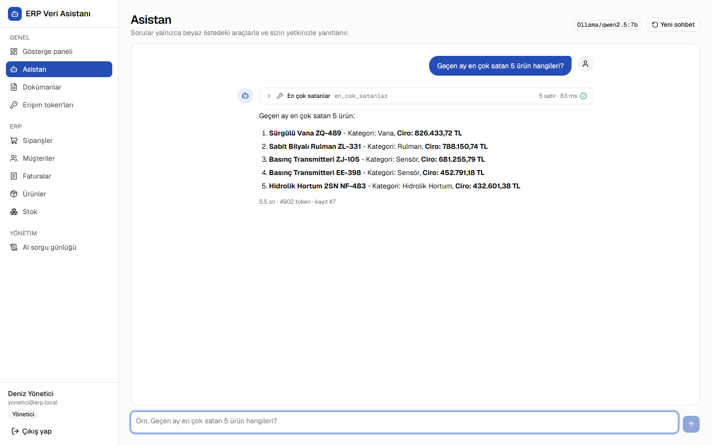
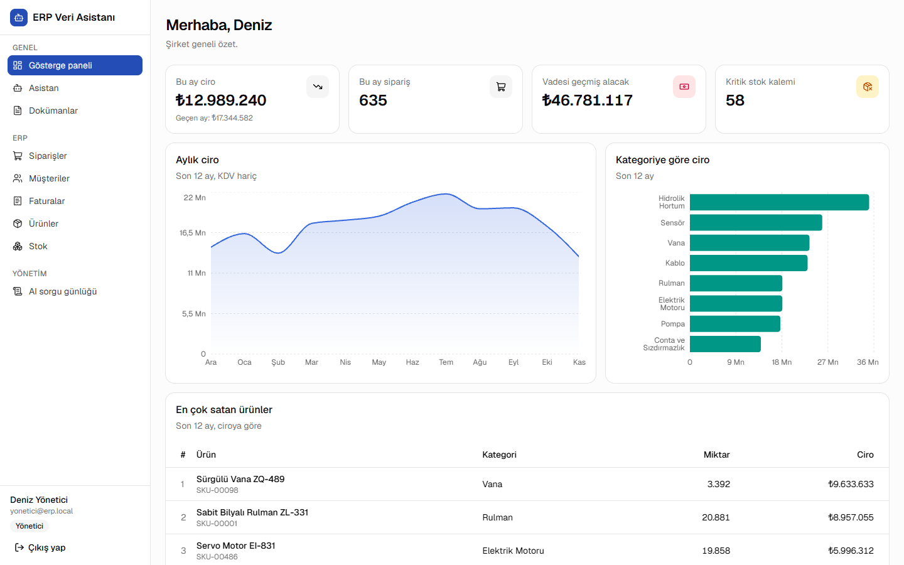
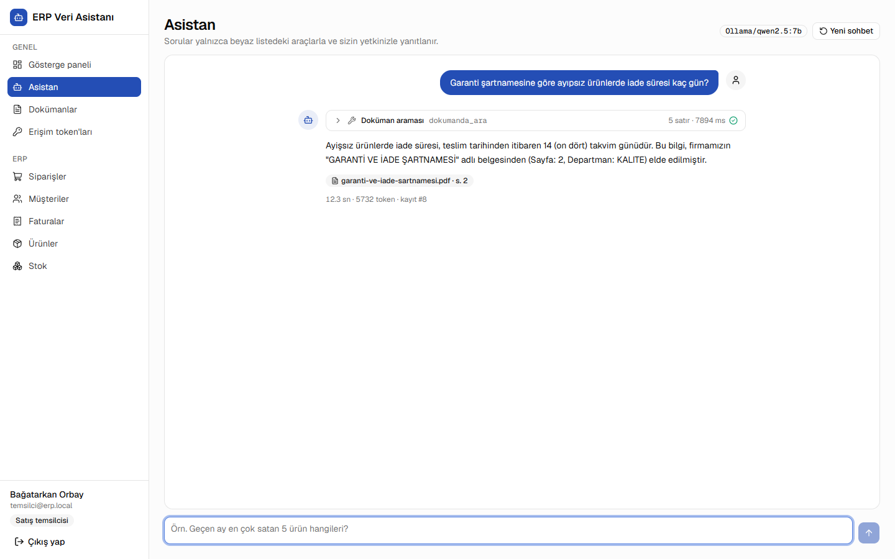
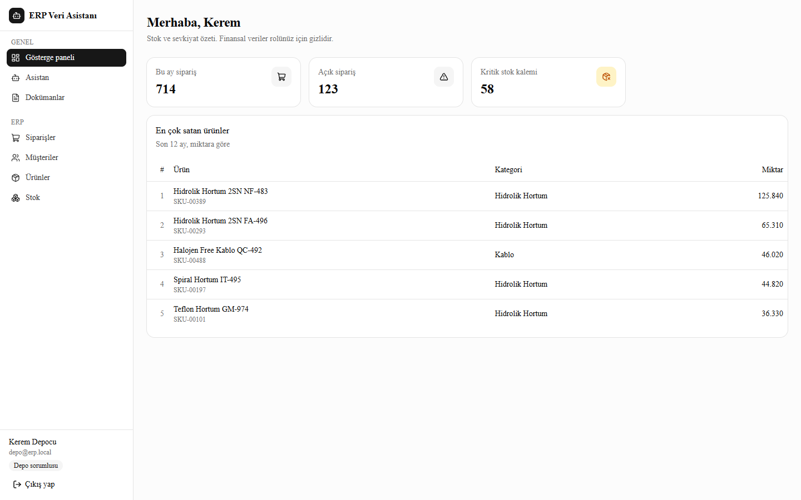
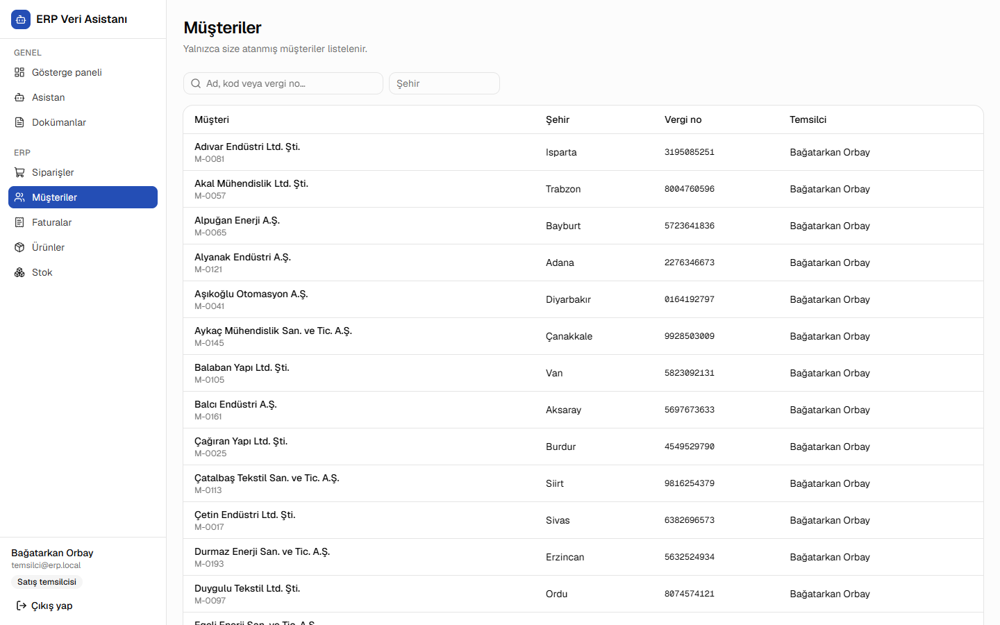
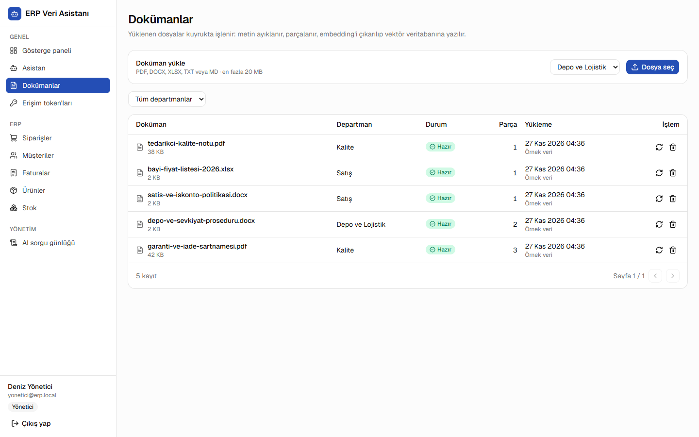
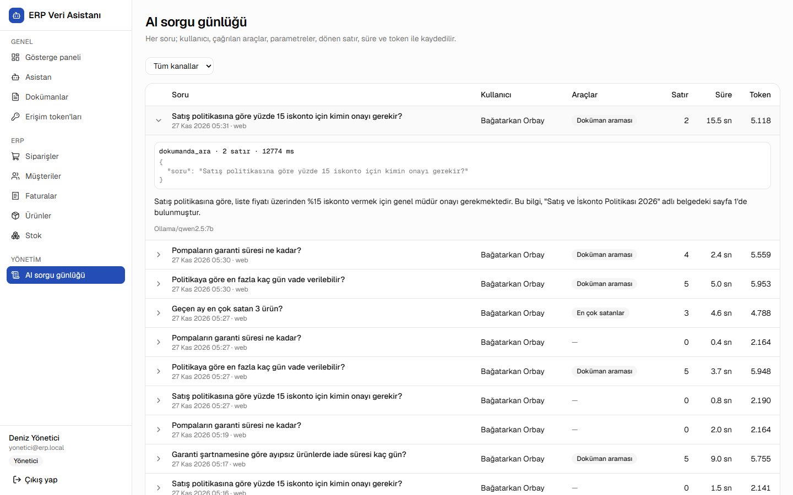
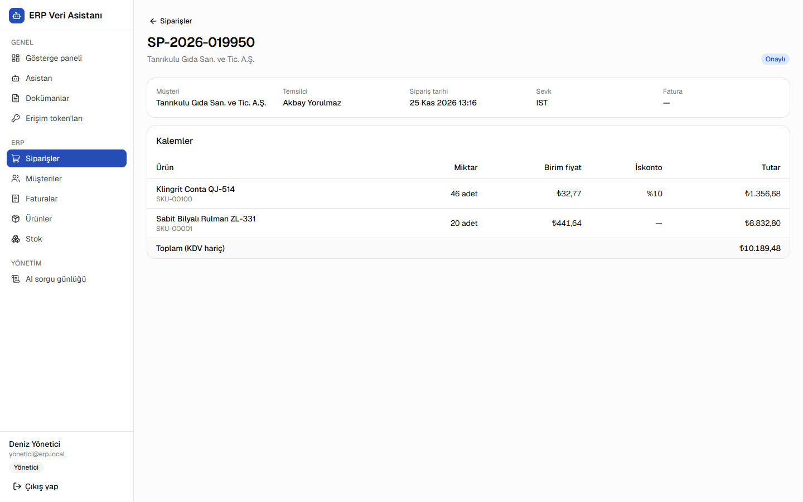
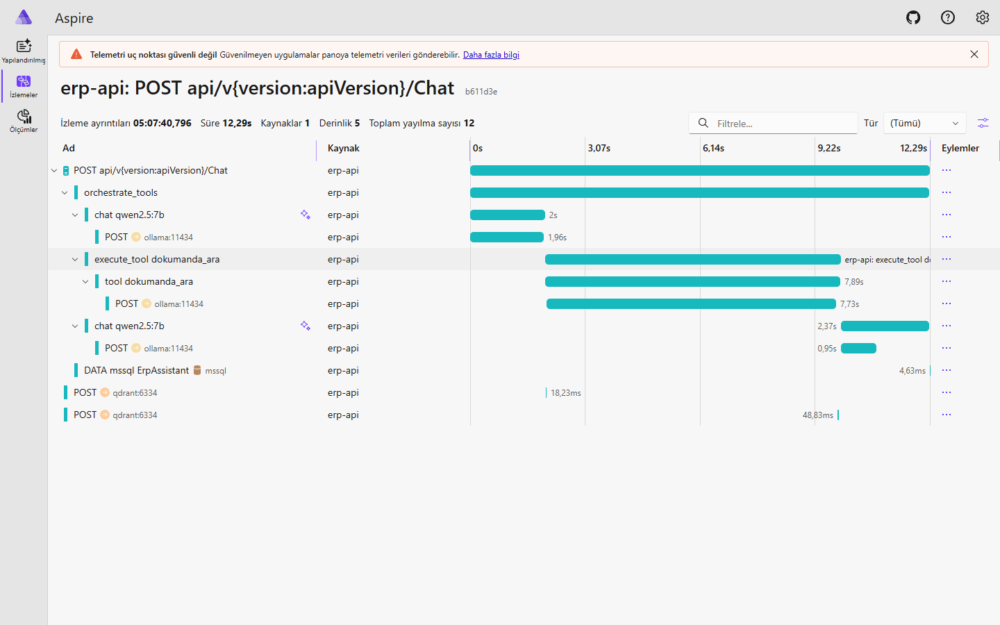
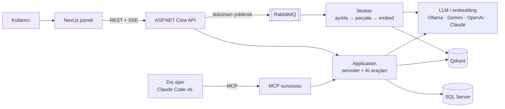

# ERP Veri Asistanı

Üretim ve satış yapan orta ölçekli bir firmanın ERP verisi (ürün, stok, müşteri, sipariş, fatura) üzerinde
çalışan, **yetkiye duyarlı** bir yapay zekâ asistanı ve yönetim paneli.

Kullanıcı doğal dille sorar — *"Geçen ay en çok satan 5 ürün?"*, *"Kahveci Endüstri'nin açık siparişleri?"*,
*"Garanti şartnamesinde iade süresi ne?"* — asistan şirket verisinden ve yüklenen dokümanlardan, hangi aracı
hangi parametrelerle çağırdığını göstererek ve kaynak belirterek cevap verir. Satış temsilcisi yalnızca kendi
müşterilerini görür; asistan da MCP üzerinden bağlanan ajanlar da aynı kurala tabidir.



## Özellikler

- **Tipli araçlarla function calling.** Model serbest SQL üretmez; 7 beyaz listeli araçtan birini seçer,
  parametreleri JSON Schema'ya göre doldurur, sunucu her parametreyi yeniden doğrular.
- **Satır ve rol bazlı yetki.** EF Core global query filter'ları REST API, asistan ve MCP'de aynı;
  depo sorumlusu fiyat ve ciro görmez, temsilci başka temsilcinin müşterisini kimlikle bile açamaz.
- **RAG.** PDF, DOCX, XLSX yükleme → RabbitMQ kuyruğu → worker (ayıkla, sayfa numaralı parçala, embedding)
  → Qdrant. Cevaplar doküman ve sayfa gösterir; ilgili parça yoksa "bulamadım" der.
- **Prompt injection savunması.** Doküman içindeki talimatlar veri sayılır; yapay zekâya yönelik talimat
  cümleleri modele gitmeden ayıklanır. Gerçek modelle test edilir.
- **MCP sunucusu.** Aynı araçlar resmi C# MCP SDK ile Claude Code gibi ajanlara açılır; kişisel erişim
  token'ı sahibinin yetkisini taşır.
- **Sağlayıcıdan bağımsız LLM.** Varsayılan yerel Ollama (ücretsiz, çevrimdışı); Gemini, OpenAI veya Claude
  yalnızca yapılandırmayla seçilir.
- **Sorgu günlüğü.** Her soru: kullanıcı, kanal, çağrılan araçlar, parametreler, dönen satır, süre, token.
- **Gözlemlenebilirlik.** OpenTelemetry izleri (HTTP, EF Core, LLM çağrıları, araçlar), metrikler,
  `/health/ready` ve Aspire paneli.

## Hızlı başlangıç

Gereksinim: Docker (Desktop). NVIDIA GPU varsa model yanıtları belirgin şekilde hızlanır.

```bash
git clone https://github.com/CeyDrew/erp-data-assistant.git
cd erp-data-assistant
docker compose up -d --build
# NVIDIA GPU ile:
docker compose -f docker-compose.yml -f docker-compose.gpu.yml up -d --build
```

İlk açılışta sentetik veri (200 müşteri, 500 ürün, 20.000 sipariş) yüklenir, 5 örnek doküman işlenir ve
Ollama modelleri indirilir (`qwen2.5:7b` ≈ 4,7 GB, `bge-m3` ≈ 1,2 GB; yalnızca bir kez).

| Adres | |
|---|---|
| http://localhost:3000 | Panel |
| http://localhost:5080/scalar | API dokümantasyonu (OpenAPI) |
| http://localhost:5080/health/ready | Bağımlılık durumu |
| http://localhost:5090/mcp | MCP sunucusu |
| http://localhost:18888 | Aspire paneli (izler, metrikler, günlükler) |
| http://localhost:15672 | RabbitMQ yönetimi (guest/guest) |

**Demo hesapları** (şifre `Demo123!`):

| E-posta | Rol | Görür |
|---|---|---|
| `yonetici@erp.local` | Yönetici | Her şey |
| `temsilci@erp.local` | Satış temsilcisi | Yalnızca kendi müşterileri, onların sipariş ve faturaları |
| `depo@erp.local` | Depo sorumlusu | Stok ve sevkiyat; fiyat, ciro ve fatura yok |

### Bulut modeliyle çalıştırma

```bash
AI_PROVIDER=Anthropic ANTHROPIC_API_KEY=sk-ant-... docker compose up -d --build
AI_PROVIDER=OpenAI    OPENAI_API_KEY=sk-...         docker compose up -d --build
AI_PROVIDER=Gemini    GEMINI_API_KEY=...            docker compose up -d --build
```

Embedding sağlayıcısı ayrı seçilir (`AI_EMBEDDING_PROVIDER=Ollama|OpenAI|Gemini`).

## Ekran görüntüleri

| | |
|---|---|
|  |  |
| Gösterge paneli (yönetici) | Doküman sorusu: kaynak ve sayfa |
|  |  |
| Depo sorumlusu: finansal veri yok | Temsilci: yalnızca kendi müşterileri |
|  |  |
| Doküman hattı durumu | AI sorgu günlüğü |
|  |  |
| Sipariş detayı | Bir sorunun izi: HTTP → LLM → araç → SQL |

## Mimari



Clean Architecture: `Api, Worker, Mcp → Infrastructure → Application → Domain`. Ayrıntılar:
[mimari](docs/architecture.md) · [ER diyagramı](docs/er-diagram.md) · [AI güvenlik kuralları](docs/ai-guardrails.md) ·
[MCP](docs/mcp.md) · [performans ölçümleri](docs/performance.md) · [mimari kararlar (ADR)](docs/adr/)

## Asistanın araçları

| Araç | Ne yapar |
|---|---|
| `satis_ozeti` | Tarih aralığında ciro ve sipariş sayısı; güne, aya, kategoriye, temsilciye veya müşteriye göre |
| `en_cok_satanlar` | Ciroya veya miktara göre en çok satan ürünler, isteğe bağlı kategori |
| `musteri_ara` | Ad, kod veya vergi numarasıyla müşteri bulur |
| `musteri_siparisleri` | Müşterinin açık/tüm siparişleri (müşteri adı sunucuda çözülür) |
| `stok_durumu` | Ürün × depo bakiyesi, kritik seviye filtresi |
| `geciken_tahsilatlar` | Vadesi geçmiş, ödenmemiş faturalar |
| `dokumanda_ara` | Yüklü dokümanlarda anlamsal arama, kaynaklı |

Yerel `qwen2.5:7b` ile 30 soruluk değerlendirmede doğru araç + parametre oranı **%97**
([sonuçlar](docs/ai-eval-results.md)).

## Teknolojiler

| Alan | Kullanılan |
|---|---|
| Backend | .NET 10, ASP.NET Core Web API, EF Core 10, SQL Server 2022, FluentValidation, Asp.Versioning, Serilog, Scalar |
| Kimlik | ASP.NET Core Identity, JWT + dönen refresh token (yeniden kullanım tespiti), kişisel erişim token'ları |
| AI | Microsoft.Extensions.AI (`IChatClient`, function invocation, OpenTelemetry), OllamaSharp, OpenAI ve Anthropic SDK'ları |
| RAG | Qdrant, PdfPig, DocumentFormat.OpenXml, `bge-m3` embedding |
| Mesajlaşma | RabbitMQ (`RabbitMQ.Client` 7): gecikmeli yeniden deneme, dead-letter |
| MCP | ModelContextProtocol C# SDK (Streamable HTTP) |
| Frontend | Next.js 16, React 19, TypeScript, Tailwind CSS 4, shadcn/ui, TanStack Query, Recharts |
| Test | xUnit, FluentAssertions, Testcontainers (SQL Server, RabbitMQ, Qdrant), sahte `IChatClient`, gerçek modelle eval |
| Altyapı | Docker Compose, GitHub Actions, OpenTelemetry + Aspire paneli |

## Geliştirme

```bash
# Altyapı servisleri
docker compose up -d mssql rabbitmq qdrant ollama ollama-init

# Backend (her biri ayrı terminalde)
dotnet run --project src/ErpAssistant.Api --urls http://localhost:5080
dotnet run --project src/ErpAssistant.Worker
dotnet run --project src/ErpAssistant.Mcp

# Panel
cd web && npm install && npm run dev
```

### Testler

```bash
dotnet test tests/ErpAssistant.UnitTests          # domain, yetki politikası, araç şemaları, metin ayıklama
dotnet test tests/ErpAssistant.IntegrationTests   # Docker gerekir: SQL Server + RabbitMQ + Qdrant konteynerleri
AI_EVAL=1 dotnet test tests/ErpAssistant.AiEvals  # gerçek modelle araç seçimi ve prompt injection değerlendirmesi
```

| Paket | Kapsam |
|---|---|
| UnitTests (44) | Sipariş/fatura/stok kuralları, `AccessPolicy`, araç kataloğu ve şemaları, injection filtresi, metin ayıklama ve parçalama |
| IntegrationTests (36) | REST uç noktaları, satır yetkisi, token yaşam döngüsü, asistan akışı (SSE), RAG hattı, retry/dead-letter, MCP |
| AiEvals (2) | 30 soruluk araç seçimi (eşik %90), dokümana gömülü talimat testi |

### Örnek dokümanlar

`samples/documents` altındaki dosyalar `tools/ErpAssistant.SampleDocs` ile üretilir; biri bilerek
yapay zekâya talimat veren bir paragraf içerir (güvenlik testi).

```bash
dotnet run --project tools/ErpAssistant.SampleDocs
```

## Proje yapısı

```
src/
├── ErpAssistant.Domain/          entity'ler ve iş kuralları
├── ErpAssistant.Application/     servisler, DTO'lar, AI araçları, yetki politikası
├── ErpAssistant.Infrastructure/  EF Core, Identity, RabbitMQ, Qdrant, LLM sağlayıcıları, telemetri
├── ErpAssistant.Api/             REST + SSE
├── ErpAssistant.Worker/          doküman işleme
└── ErpAssistant.Mcp/             MCP sunucusu
tests/                            birim, integration (Testcontainers), AI değerlendirmeleri
web/                              Next.js paneli
docs/                             mimari, ADR'ler, performans, tasarım notları
samples/documents/                örnek şirket dokümanları
```

Tüm müşteri, ürün ve sipariş verisi sentetiktir (Bogus ile üretilir).

## Lisans

MIT
