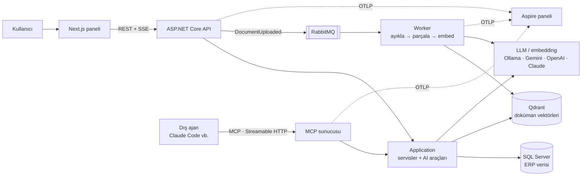
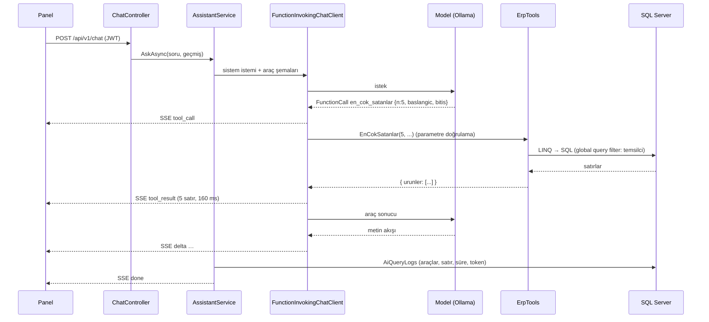

# Mimari

## Bir sorunun yolculuğu

## Projeler

| Proje | Sorumluluk |
|---|---|
| `ErpAssistant.Domain` | Entity'ler, iş kuralları (sipariş yaşam döngüsü, KDV, tahsilat, stok hareketi işareti) |
| `ErpAssistant.Application` | Servisler (ürün, stok, müşteri, sipariş, fatura, rapor, doküman), AI araçları ve istem, `AccessPolicy`, arayüzler |
| `ErpAssistant.Infrastructure` | EF Core + migration'lar + tohumlama, Identity/JWT/PAT, RabbitMQ, Qdrant, LLM ve embedding sağlayıcıları, metin ayıklama, OpenTelemetry, sağlık kontrolleri |
| `ErpAssistant.Api` | REST + SSE, ProblemDetails, versiyonlama, hız sınırı, OpenAPI/Scalar |
| `ErpAssistant.Worker` | Doküman kuyruğu tüketicisi |
| `ErpAssistant.Mcp` | MCP sunucusu |
| `web/` | Next.js paneli |
| `tools/ErpAssistant.SampleDocs` | Örnek şirket dokümanlarını üretir |

## Yetki modeli

| Rol | Satırlar | Finansal veri | Dokümanlar |
|---|---|---|---|
| Yönetici | hepsi | evet | hepsi |
| Satış temsilcisi | yalnızca kendi müşterileri, siparişleri, faturaları | evet | Satış, Kalite |
| Depo sorumlusu | tüm siparişler (sevkiyat için), stok | hayır (fiyat, ciro, fatura gizli) | Depo, Kalite |

Kuralların tek kaynağı `AccessPolicy`. EF Core global query filter'ları, servis projeksiyonları, AI
araçları, vektör araması ve MCP aynı değerleri okur. Ayrıntı: [ADR 0003](adr/0003-satir-yetkisi-global-query-filter.md).

## Gözlemlenebilirlik
- **İzler:** ASP.NET Core, HttpClient, EF Core, LLM çağrıları (OpenTelemetry GenAI semantik kuralları:
  model, token), her araç çağrısı (`tool <ad>` span'i, dönen satır) ve doküman işleme.
- **Metrikler:** `erp.ai.tool_calls`, `erp.ai.tool_duration`, `erp.documents.processed`,
  `erp.documents.duration`, LLM token kullanımı, istek/çalışma zamanı metrikleri.
- **Sağlık:** `/health` (süreç), `/health/ready` (SQL Server, RabbitMQ + dead-letter sayısı, Qdrant, Ollama
  modelleri indirilmiş mi).
- Compose'da Aspire paneli: http://localhost:18888
