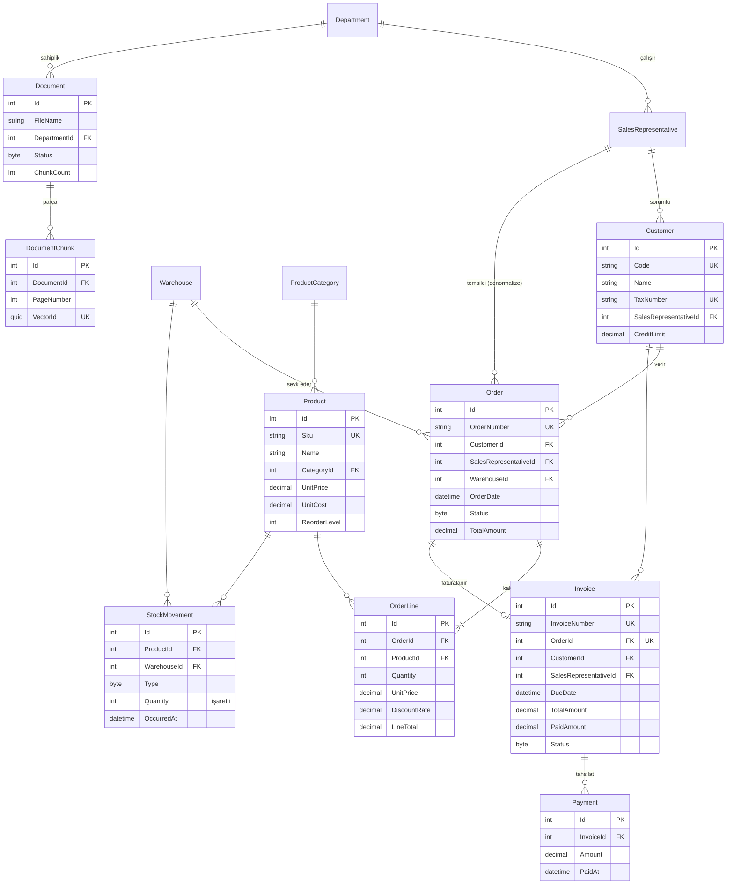

# ERP veri modeli

Tabloya dahil olmayanlar:

- **`vw_StockBalance`** — `StockMovements` üzerinde `WITH SCHEMABINDING` indekslenmiş view
  (`ProductId, WarehouseId` benzersiz clustered index). Bakiye hiçbir tabloda saklanmaz; SQL Server
  view'ı her hareket insert'inde günceller.
- **`AiQueryLogs`** — asistana sorulan her soru, çağrılan araçlar ve dönen satır sayısı.
- **ASP.NET Core Identity tabloları** (Faz 3) — kullanıcı, rol ve yenileme token'ları.

## Denormalizasyon kararı

`Orders.SalesRepresentativeId` ve `Invoices.SalesRepresentativeId` müşteriden kopyalanır. Böylece:

- satır yetkisi filtresi (`WHERE SalesRepresentativeId = @rep`) join'siz ve index üzerinden çalışır,
- müşteri başka temsilciye devredildiğinde geçmiş satışlar eski temsilcide kalır (komisyon raporu
  açısından doğru davranış).

## Sentetik veri

`ErpDataSeeder` (Bogus, `tr` yereli, sabit tohum):

| Varlık | Adet |
|---|---|
| Departman | 4 |
| Satış temsilcisi | 8 |
| Depo | 3 |
| Ürün kategorisi / ürün | 12 / 500 |
| Müşteri | 200 |
| Sipariş / kalem | 20.000 / ≈54.000 |
| Fatura / tahsilat | ≈19.000 / ≈17.000 |

Sipariş tarihleri son 24 aya yayılır; hafif büyüme trendi, mevsimsellik ve hafta sonu düşüşü vardır.
Ürün ve müşteri seçimi ağırlıklıdır (az sayıda ürün satışların büyük kısmını yapar). Ödeme davranışı:
%72 vadesinde, %15 geç, %7 kısmi, %6 hiç ödemiyor — "geciken tahsilatlar" sorusu için.
